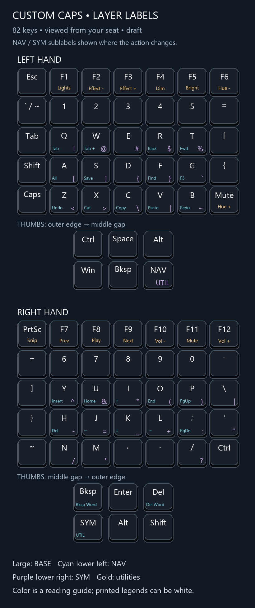
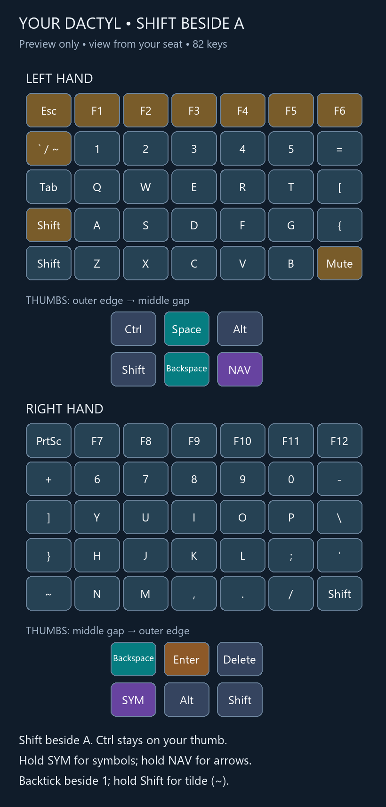

# My Skree keyboard layouts

## Current wired QMK/Vial layer draft

[Download the layered draft](layouts/vial/layered-draft/qwerty-layered-draft.vil) · [Base layout](layouts/vial/layered-draft/base.png) · [Custom cap legends](layouts/vial/layered-draft/keycaps.png) · [All 82 labels](layouts/vial/layered-draft/keycap-labels.csv)

The October 22, 2026 research revision balances programming comfort, familiar QWERTY positions, and immediate gaming inputs. It targets the wired Skree 5×7+6 with 82 physical keys, a 12×7 matrix, Vial UID `8490061865922939121`, and USB `9953:0002`.

- The left thumb cluster's top row is **Ctrl / Space / Alt**, from the outer edge toward the middle gap. All three are ordinary dedicated keys, as requested; simultaneous use is not required. Exactly two base Shifts remain: beside A and on the right thumb. Additional Ctrl keys are beside Z and on the right pinky. Win stays on a dedicated left thumb key.
- WASD, modifiers, and Space are immediate ordinary keys. There are no mod-taps, layer-taps, sticky modifiers, tap dances, or active letter combos. Normal Ctrl+Z/X/C/V/S/F shortcuts work on the base layer; duplicate NAV macros have been removed.
- [NAV](layouts/vial/layered-draft/nav.png): hold the left NAV thumb key. I/J/K/L are Up/Left/Down/Right; U/O are Home/End. While NAV is held, A/S/D/F become plain Win/Alt/Shift/Ctrl. For example, NAV+F+J is Ctrl+Left, and adding D selects the previous word. Thumb Backspace/Delete retain their normal functions; adding Ctrl deletes words. These layer modifiers have no tap/hold timing and do not change base letters.
- [SYM](layouts/vial/layered-draft/sym.png): hold the right SYM thumb key. QWERT and YUIOP retain `! @ # $ %` and `^ & * ( )` in number-row order. Home-row pairs are A/S = `[]`, D/F = `()`, K/L = `{}`. J is `=`, G is `+`, H is `-`, and M is `_`. Comma/period keep their base positions. Backtick stays beside 1; the normal US Shift symbols remain available.
- [Utilities](layouts/vial/layered-draft/util.png): hold both thumb keys in either order. F1–F6 control lighting; F7–F12 control media and volume. Mute becomes Hue+, PrtSc becomes Windows region screenshot (`Win+Shift+S`), and the pinky Ctrl becomes Caps Lock. Other keys retain base actions regardless of thumb press order.
- Cap draft: large base legend, NAV at the lower left, SYM at the lower right. Utility labels sit on the function row, PrtSc, Mute, and pinky Ctrl. Image colors explain the layers; printed legends can all be white. The fifth firmware layer is unused.

**Status:** all 410 populated bindings passed offline Vial parsing. Checks also cover two base Shifts, unchanged alphanumerics, standard US punctuation, unused timing/combination features, usable modifiers, and both thumb press/release orders. This draft has not been written to or physically tested on the keyboard. General key reach and cap font/spacing still need checking before ordering printed caps.

To load, connect the halves as usual and plug the PC cable into the right half's upper USB port. Save a backup in Vial, confirm the matching keyboard, then choose **File → Load saved layout** and select `layered-draft/qwerty-layered-draft.vil`. Loading writes the configuration to the keyboard. Check typing, modifiers, navigation, symbols, and both layer keys on the hardware.

### Research and design tradeoffs

This is a custom adaptation of documented ideas, not an official Miryoku or Seniply layout. With 82 keys, the number row, F row, and dedicated modifiers can stay available; extra number/function layers would add little for this user's priorities.

| Approach considered | Benefit | Decision for this draft |
| --- | --- | --- |
| Dedicated modifiers and momentary thumb layers | Familiar press/hold behavior | Base layout uses these |
| Home-row letter/modifier tap-holds | Less reach and fewer dedicated keys | Excluded for gaming and predictable letter behavior |
| Plain home-row modifiers on NAV | Convenient Ctrl/Shift/Alt navigation without timing decisions | Use only while NAV is held |
| One-shot/sticky modifiers | Can enter a chord one key at a time | Excluded to avoid queued modifier state |
| Letter combos and tap dances | More actions with fewer physical keys | Excluded; enough dedicated keys are available |

[Precondition's guide](https://precondition.github.io/home-row-mods) documents both home-row mod-taps and the alternative of thumb-selected layers containing plain modifiers. [QMK's tap-hold documentation](https://docs.qmk.fm/tap_hold) explains the ambiguity between typed rolls and held modifiers, plus modern Chordal Hold and Flow Tap mitigations. They can help an experiment, but this draft avoids that ambiguity entirely. The saved firmware source has not been shown to support those newer mitigations, and they are not required here. [QMK one-shot keys](https://docs.qmk.fm/one_shot_keys) explains the queued modifier alternative. [Callum's current keymap](https://github.com/callum-oakley/keymap) offers half-layers as another way to avoid mod-tap timing; its extra layer choreography is unnecessary for this baseline.

[Miryoku's reference](https://github.com/manna-harbour/miryoku/blob/master/docs/reference/readme.org) emphasizes nearby keys, thumb layers, and accessible modifiers. [Seniply](https://stevep99.github.io/seniply/) groups related symbols and provides modifiers alongside navigation. This revision borrows those principles while preserving QWERTY and ordinary gaming keys.

[Getreuer's symbol-layer guide](https://getreuer.info/posts/keyboards/symbol-layer/index.html) weighs symbol frequency, common code sequences, repeated symbols, and learnability. Here, parentheses move from ring/pinky top-row positions to left middle/index home positions, opposite the right-thumb SYM hold. All three bracket pairs are adjacent on the home row. Keeping the top-row mnemonic intentionally duplicates parentheses; it provides a familiar fallback. Square brackets still use the left pinky/ring, which is the main compromise. Operators `=`, `+`, `-`, `_`, `/`, `*`, `&`, and `|` have index, middle, or ring-finger options. Patterns considered include `()`, `[]`, `{}`, `!=`, `<=`, `>=`, `+=`, `=>`, `->`, `/*`, and `*/`; no claim of globally optimal speed or physical comfort is made.

Start with ordinary typing and Ctrl shortcuts, then learn NAV arrows, then the three bracket pairs. The rest of SYM can be learned as needed. Final symbol priorities can be adjusted for the user's programming languages after actual use.

## Previous wired preview

[Download the reviewed layout](layouts/vial/qwerty-shift-a.vil) · [Full-size picture](layouts/vial/layout.png) · [Key labels and layer actions](layouts/vial/keycap-labels.csv)

The October 22, 2026 layout is for the wired Skree Custom Keyboards 5×7+6: 82 physical keys, a 12×7 matrix, five layers, and Vial keyboard UID `8490061865922939121` (USB `9953:0002`).

- Esc is at the top left; F1–F6 follow across the left half.
- Backtick is beside 1. Shift + backtick produces tilde on a US keyboard layout.
- Shift is directly left of A, with the existing Shift beside Z also available.
- Ctrl stays on the left thumb. Mute moves to the left inner bottom key.
- Hold NAV for navigation, SYM for symbols, or both for utilities. Those layers and the thumb mappings retain the earlier wired layout's assignments.

### Load in Vial

Connect the halves as usual and plug the PC cable into the right half's upper USB port. In Vial, select the matching keyboard, save its current layout as a backup, then use **File → Load saved layout** to load `qwerty-shift-a.vil`. Loading a saved layout writes the configuration to the keyboard.

**Status:** the 410 populated layer bindings passed offline Vial keycode validation. This revision has not yet been written to or physically tested on the keyboard. Check typing, modifiers, and both layer keys after loading it.

## Earlier wireless ZMK firmware

The existing `boards/`, `config/`, `build.yaml`, and build workflow describe the older XIAO BLE/ZMK setup. Its [Skree keymap](boards/shields/skreecustom/skreecustom.keymap) remains the reference for that wireless firmware. The current wired layout above is loaded through Vial and does not require rebuilding ZMK.
